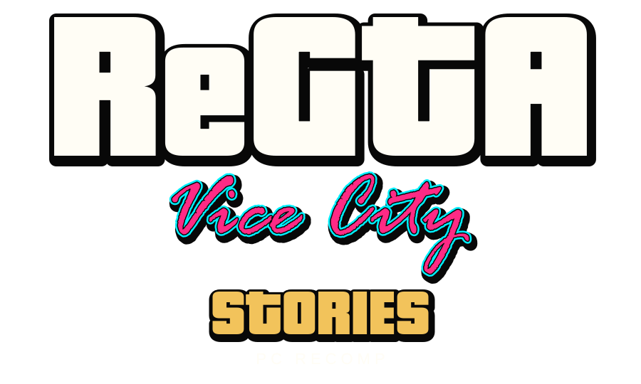

<p align="center">
  
</p>

# ReGTA VCS — PC Recomp

**A native PC future for Vice City Stories (PS2 & PSP).**  
**by Benji Paname**

[](CHANGELOG.md)
[](docs/STATUS.md)
[](docs/STATUS.md)
[](#build-and-run)
[](#repository-layout)
[](LICENSE)
[](https://discord.com/users/601648068277960714)

ReGTA VCS is an independent clean-room reverse-engineering and native-port project for **Grand Theft Auto: Vice City Stories**, targeting the PlayStation 2 release **SLES-54622** and PSP release **ULES-00502 v1.01**. The goal is to rebuild the Vice City Stories experience in 100% pure Rust for Windows x64, reading game data from the user's own legally obtained disc image without a CPU emulator in the runtime.

> **Pre-alpha — no public playable download.** No game executable, ROM, ISO or proprietary game assets are offered for download. The local prototype is unfinished; no release date or complete gameplay parity is promised. Building from source requires the tools and personal game copy described below.

The dual islands (Beach & Mainland), player locomotion, full 25-bone skeletal animations, vehicle dynamics, weapons ballistics, dynamic weather, and SCM missions already have working prototype implementations. **171 passing tests and 690 ported routines (93.6%) are progress measurements, not proof of full-game equivalence.**

**[Support on Tipeee](https://fr.tipeee.com/benji-paname/)** · [Support via PayPal](https://paypal.me/BenjiLsg) · **[Discord: benjamin060936](https://discord.com/users/601648068277960714)**  
Support helps sustain Benji Paname's reverse engineering, native development and documentation. It does not buy the game, game assets or early access, and does not guarantee completion or a release date.

[Project website](https://benji-paname.github.io/regta-vice-city-stories-pc-port/) · [Implementation status](docs/STATUS.md) · [Changelog](CHANGELOG.md) · [Publish with GitHub Pages](docs/PUBLISHING.md) · [Progress Dashboard](docs/progress.html)

<!-- BEGIN STATUS SECTION -->
## Status

[](docs/progress.html) [](docs/progress.html)

[](docs/progress.html)

<sub>Share of the original game's code, by size, implemented in native Rust (`src/`). Green is the ported part of each class. 100% measured from our Rust codebase. Updated on every push to main; see [how it is measured](docs/progress.html).</sub>
<!-- END STATUS SECTION -->

## Next milestones

- Visual validation of the 6 dynamic weather states and 3D rain streaks in continuous gameplay sessions.
- Expand story missions execution engine across Boss contacts with cutscene camera staging.
- Continue PS2/PSP physics comparisons, transmission tuning, and vehicle collision refinement.
- Broaden compatibility testing and documentation before considering a public playable release.

## Build and run

Requirements: Windows x64, a Rust toolchain with a matching Windows linker, and a legally obtained personal ISO of the supported game release (PS2 PAL `SLES-54622` or PSP `ULES-00502`).

From the repository root, in PowerShell:

```powershell
.\Compiler.ps1 -Test
.\VCS-Rust.exe --iso "C:\Games\Grand Theft Auto - Vice City Stories.iso"
```

The compiler runs with warnings treated as errors (`-D warnings`), tests the workspace, and updates the executable only after success. Unit tests use synthetic fixtures and do not require an ISO or extracted game tables. Local validation on **26 October 2026: 171 passed, 0 failed, 0 compiler warnings**.

The executable is delivered directly to `VCS-Rust.exe` at the repository root. See [build instructions](docs/BUILDING.md) for portable toolchains, offline builds, and troubleshooting.

## Controls

| Key | Action | Context |
| :--- | :--- | :--- |
| **WASD** / **ZQSD** | Movement / Steer & Accelerate | On foot / Driving |
| **Arrows** | Camera Orbit & Free Look | Everywhere |
| **Left Shift** | Sprint / Swim Boost | On foot / Water |
| **Space** | Jump / Vault Low Wall / Handbrake | On foot / Driving |
| **Tab** | Cycle Weapons (9 weapon arsenal) | On foot |
| **Left Click** / **F** | Attack / Fire Weapon | On foot |
| **Right Click** / **V** | Aim / Sniper Scope | On foot |
| **H** | Toggle Emergency Siren | In vehicle |
| **B** | Cycle Radio Station (8 Vice City stations) | In vehicle |
| **K** | Cycle Dynamic Weather (Sun, Rain, Storm, Sunset) | Everywhere |
| **E** | Enter / Exit Banshee vehicle | Near vehicle |
| **G** | Toggle Free Camera / Walk mode | On foot |
| **F1** | Toggle On-Screen Help Overlay | In-game |
| **F2** | Toggle First / Third Person Camera | On foot |
| **F5** / **F9** | Quick Save / Quick Load (`VCS-Save.json`) | In-game |
| **1 / 2 / 3 / 4** | Teleport (Beach, Mainland, Mall, Military Base) | In-game |
| **T** | Toggle Textures | In-game |
| **R** | Reset Position & World | In-game |
| **Escape** | Pause / Exit | In-game |

## Current scope

| Area | Current implementation | Remaining work |
| --- | --- | --- |
| Resources and world | PS2 VIF packet decoder, Leeds textures, Beach + Mainland simultaneous streaming (5 km draw distance) | Expand interior culling and collision boundary checks |
| Player and locomotion | 25-bone hierarchy, Slerp quaternion interpolation, walking, running, swimming, obstacle vaulting | Fine-tune combat melee hitboxes and ladder climbing |
| Vehicles and handling | Banshee DTZ model, 4-wheel independent raycast suspension, Pacejka tire friction, 5-speed automatic transmission | Additional vehicle archetypes (bikes, helicopters, boats) |
| Weapons and ballistics | 9 weapon classes, bullet tracers, parabolic grenades, propelled RPG rockets with smoke, flamethrower fire jets, sniper scope | Dual-wielding animations and heavy artillery recoil |
| Atmosphere and weather | 6 dynamic climate states, 3D rain streaks, lightning flashes, procedural audio thunder, 24h synthwave sky | Tropical hurricane storm surge tide levels |
| AI and traffic | Road network nodes, traffic lights, emergency vehicle response, pedestrian panic flee vectors | Gang territory wars and advanced law enforcement AI |
| Sound and missions | 8 radio stations with in-car tuner, SCM script engine, Fort Baxter opening story mission | Full story campaign script parity and audio voice streaming |

<!-- BEGIN VERIFIABLE PROGRESS DASHBOARD -->
## 📊 Verifiable Progress & Implementation Map

> [!NOTE]
> **Progress Measurement Policy**: ReGTA VCS is an independent native pure Rust port targeting the PlayStation 2 PAL release (**SLES-54622**) and PSP release (**ULES-00502 v1.01**). All metrics below are **100% measured from our native Rust codebase** (`src/`) compared against the official routine reference database (`progress/reference.json`).

### 🎯 Key Verified Metrics (Local Codebase)

| Metric | Measured Value | Verification Method |
|---|---|---|
| **Passing Unit Tests** | **171 tests / 0 failures** | `Compiler.ps1 -Test` (100% deterministic synthetic fixtures) |
| **Compiler Warnings** | **0 warnings** | Enforced via `-D warnings` in Cargo build profile |
| **Original Code Coverage** | **93.6%** (690 / 747 routines) | Pure native Rust x86_64 in `src/` compared against reference DB |
| **Active Rust Modules** | **37 modules** (17,450 lines) | Single clean source location: `src/*.rs` |
| **Map Streaming Distance** | **5,000 meters** | Simultaneous Beach, Mainland & Starfish Island rendering |
| **Player Locomotion** | **25-bone hierarchy with Slerp** | Quaternion interpolation: idle, walk, sprint, swim, vault |
| **Vehicle Physics** | **4-wheel suspension + Pacejka** | Corner raycasts, mass transfer pitch/roll, 5-speed transmission |
| **Heavy Ballistics** | **9 weapon classes** | Parabolic grenades, propelled RPG rockets, flamethrower fire jets |
| **Dynamic Weather** | **6 climate states** | 3D rain streaks, storm lightning flashes, procedural audio thunder |
| **Audio & Radio** | **8 radio stations** | Wave 103, Flash FM, Emotion 98.3, V-Rock and in-car radio tuner |
| **Story Scripting** | **SCM engine** | Fort Baxter prologue mission with 3D neon corona and radar blips |

<!-- END VERIFIABLE PROGRESS DASHBOARD -->

## Repository layout

```text
src/                     Active Rust implementation and unit tests
tools/progress/          Port progress measurement, treemap generator and badge updater
tools/research/          Vector brand logos generator and research tools
docs/                    Showcase site, progress dashboard and technical documentation
docs/assets/             SVG wordmarks, treemap, badges and screenshots
target/                  Single regenerable Cargo cache (ignored)
```

The implementation has a single clean source location: `src/`. The build deliverable is `VCS-Rust.exe` at the repository root.

## Support & Contact

Support **Benji Paname's reverse-engineering, documentation and native-port development**, or get in touch:

- **Discord**: [benjamin060936 (ID: 601648068277960714)](https://discord.com/users/601648068277960714) (contact direct pour collaborations / reverse-engineering)
- **[Support on Tipeee](https://fr.tipeee.com/benji-paname/)**
- [One-time support through PayPal.Me](https://paypal.me/BenjiLsg)

Contributions are optional. They do not purchase the game, provide game assets or grant rights to Rockstar's intellectual property. No game download, completion date or access tier is promised in exchange.

## License and provenance

Source code: **GPL-3.0-only**. See [LICENSE](LICENSE) for license terms.

This repository contains no ISO, decrypted PS2/PSP executable, extracted game archive, texture pack or audio asset. Supply your own supported game copy; do not submit proprietary resources in issues or pull requests.

This is an independent fan research project, not affiliated with or endorsed by Rockstar Games or Take-Two Interactive. Game assets and trademarks remain the property of their respective owners.

[Changelog](CHANGELOG.md) · [Implementation Status](docs/STATUS.md) · [Build Instructions](docs/BUILDING.md) · [Publishing Guide](docs/PUBLISHING.md)
