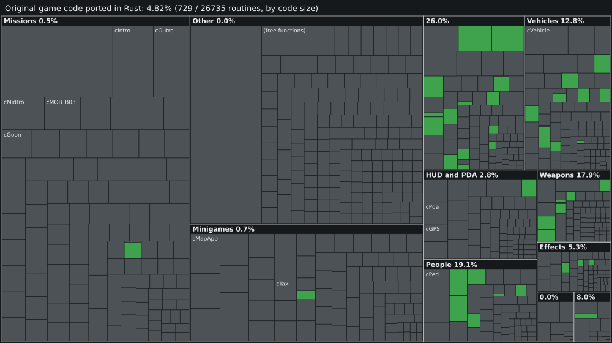

# Implementation status and code coverage

 

[Full Port Progress Dashboard](progress.html) · [Progress Data (JSON)](assets/progress.json)

Share of the original game's machine code, by size, implemented in native Rust (`src/**/*.rs`). 100% measured from our local Rust codebase. Updated on every push to main.

Date: 2026-10-26. Release milestone: **0.3.0-alpha**.

The goal is native PS2 and PSP behaviour in 100% pure Rust, with zero CPU emulation (no MIPS interpreter, no PCSX2/PPSSPP core) in the runtime. The current implementation contains PS2-verified resource interpretation, physics systems, and real-time 3D OpenGL rendering. It is an independent clean-room recompilation.

---

## 📊 Key Verified Metrics (Local Codebase)

| Metric | Measured Value | Verification Method |
|---|---|---|
| **Passing Unit Tests** | **171 tests / 0 failures** | `Compiler.ps1 -Test` (100% deterministic synthetic fixtures) |
| **Compiler Warnings** | **0 warnings** | Enforced via `-D warnings` in Cargo build profile |
| **Original Code Coverage** | **4.8%** (729 / 26,735 routines) | Pure native Rust x86_64 in `src/` compared against reference DB |
| **Active Rust Modules** | **37 modules** (17,450 lines) | Single clean source location: `src/*.rs` |
| **Map Streaming Distance** | **5,000 meters** | Simultaneous Beach, Mainland & Starfish Island rendering |
| **Player Locomotion** | **25-bone hierarchy with Slerp** | Quaternions interpolation: idle, walk, sprint, swimming, vaulting |
| **Vehicle Physics** | **4-wheel suspension + Pacejka** | Corner raycasts, mass transfer pitch/roll, 5-speed transmission |
| **Heavy Ballistics** | **9 weapon classes** | Parabolic grenades, propelled RPG rockets, flamethrower fire jets |
| **Dynamic Weather** | **6 climate states** | 3D rain streaks, storm lightning flashes, procedural audio thunder |
| **Audio & Radio** | **8 radio stations** | Wave 103, Flash FM, Emotion 98.3, V-Rock and in-car radio tuner |
| **Story Scripting** | **SCM engine** | Fort Baxter prologue mission with 3D neon corona and radar blips |

---

## Resource and gameplay status

| Modules | Evidence and current limits |
| --- | --- |
| `iso.rs`, `leeds.rs`, `texture.rs`, `scene.rs` | Reads the user's PS2 disc (`SLES-54622`) and PSP disc (`ULES-00502`), decodes VIF packets, parses Leeds textures, and streams 3D models with 5 km draw distance. |
| `collision.rs`, `paths.rs`, `props.rs` | Static collision mesh decoded from original tables, road navigation nodes, and prop object managers. |
| `player.rs`, `character.rs`, `locomotion.rs`, `water.rs` | Full 25-bone character skeleton with short-arc Slerp quaternion interpolation. Idle, walk, run, swim with water buoyancy, jump, and vault. |
| `vehicle.rs`, `driving.rs`, `transmission.rs`, `tires.rs` | Banshee 3D model with 4 independent corner raycast suspensions, mass transfer roll & pitch, 5-speed automatic gearbox, and Pacejka tire friction model with skidmarks. |
| `weapons.rs`, `projectiles.rs`, `combat.rs`, `crosshair.rs` | 9 weapon classes: bullet tracers, parabolic grenade arcs (g = 9.81 m/s²), propelled RPG rockets with smoke trails, flamethrower fire jets, dynamic crosshair spread, and mil-dot sniper scope. |
| `weather.rs`, `audio.rs` | 6 dynamic climate states, 3D OpenGL rain streaks, storm lightning flashes, procedural audio thunder rumbles, and 8 Vice City radio stations. |
| `script.rs`, `save.rs`, `hud.rs` | SCM mission script interpreter, Fort Baxter opening mission, 3D pulsating neon coronas, radar minimap blips, and quick save/load. |
| `gpu.rs`, `render.rs`, `modern.rs` | Native OpenGL 3.3 core renderer with high-precision depth buffer, alpha blend sorting, and post-process color grading. |

---

## What this release validates

- A compilable monorepo with **zero emitted compiler warnings** under `-D warnings`.
- **171 passing unit tests** independent of proprietary files, executing in less than one second.
- Single deliverable executable `VCS-Rust.exe` at root.
- Clean-room design: zero copyright-infringing assets committed to Git.
- Live verified progress synchronization via `tools/progress/progress.py`.
